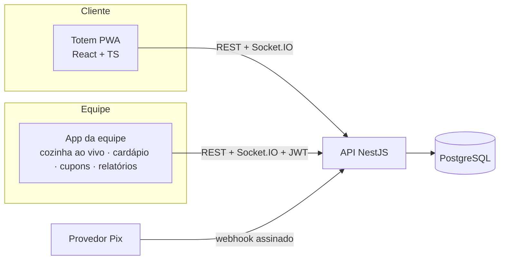

# Burger Lab: sistema de autoatendimento

Sistema completo de **totem de autoatendimento para lanchonete**: o cliente pede e paga sozinho (cartão ou Pix), a cozinha recebe o pedido ao vivo, e a gerência controla cardápio, estoque, cupons e relatórios. Foi construído como projeto de portfólio com preocupações de produção: consistência de dados, segurança, funcionamento offline, testes em três camadas, CI e deploy em um único container.



| Pacote | Descrição |
| --- | --- |
| `apps/kiosk` | Totem do cliente (React + TypeScript + Vite), instalável como PWA e com modo offline |
| `apps/admin` | App da equipe: login, cozinha ao vivo (KDS), cardápio/estoque, cupons e relatórios |
| `apps/api` | API REST + WebSocket (NestJS, Prisma, PostgreSQL); em produção também serve os dois front-ends |
| `e2e` | Testes ponta a ponta (Playwright) contra o artefato de produção |

## Funcionalidades

- **Totem**: comer aqui/levar, cardápio por categoria, personalização (remover ingredientes, adicionais), carrinho, **upsell** orientado por vendas, **cupom**, pagamento por **cartão** ou **Pix (QR Code)**, senha do pedido, timeout de inatividade, interface própria para toque (alvos grandes, foco visível, `aria-label`).
- **Cozinha ao vivo**: pedidos novos e mudanças de status chegam por WebSocket, sem recarregar.
- **Gestão**: pausar produto, ajustar preço e estoque (refletem no totem na hora), cupons (percentual/fixo, mínimo, limite de usos, validade) e relatórios (faturamento, ticket médio, pedidos por hora, mais vendidos).
- **Offline**: o totem abre sem internet, usa a última cópia do cardápio e aceita pedidos no cartão numa fila local que sincroniza ao reconectar.

- **Caixa e operação**: pagamento no caixa com senha, senha diária, tela de senhas chamadas, impressão de comprovante, usuários e troca de senha, histórico de pedidos com CSV, cadastro de produtos/adicionais/categorias, reembolso.
- **Produção**: sessão em cookie HttpOnly com logout que revoga, trilha de auditoria, logs estruturados, métricas Prometheus, Sentry opcional, backup criptografado. Veja [docs/OPERACAO.md](docs/OPERACAO.md).
- **Acessibilidade e idiomas**: totem em português e inglês (nomes e descrições do cardápio traduzíveis pelo painel), alto contraste, texto maior, navegação por teclado, varredura axe-core (WCAG 2.1 AA) nos testes.

## Decisões de projeto

**Consistência de dados**
- **Preço sempre calculado no servidor**: o cliente envia só IDs e quantidades; valores são inteiros em centavos.
- **Estoque transacional**: baixa condicional (`UPDATE ... WHERE stock >= qty`) na mesma transação do pedido; disputa pela última unidade tem um só vencedor, e o perdedor não deixa rastros (rollback).
- **Máquina de estados do pedido** (`PAID → PREPARING → READY → DELIVERED`, com cancelamento nas etapas iniciais), transições inválidas recusadas (409) e histórico em `OrderEvent`.
- **Idempotência**: cabeçalho `Idempotency-Key` impede pedido duplicado em retentativas (rede instável, fila offline).

**Pagamentos**
- **Pix com webhook**: o pedido nasce `CREATED` com cobrança `PENDING` e só chega à cozinha quando o webhook confirma. O webhook valida assinatura **HMAC-SHA256 sobre o corpo bruto** (comparação em tempo constante), confere o valor e é **idempotente**. O provedor é uma interface (`PixProvider`) com implementação simulada, trocável por um PSP real sem mexer no restante.
- **Expiração**: cobranças não pagas expiram (5 min), cancelam o pedido e devolvem estoque e uso de cupom; webhook tardio em cobrança expirada é recusado (409).
- **Cupons**: regras puras e testadas; a prévia no totem não consome o cupom, e o uso é reservado de forma **atômica** (`UPDATE ... WHERE usedCount < maxUses`), então pedidos simultâneos não passam do limite.

**Estornos e caixa**
- Cancelar um pedido já pago **estorna** o pagamento: Pix pelo provedor; cartão e dinheiro são devolvidos manualmente pela equipe (o sistema registra). Se o provedor falhar, o pagamento fica `REFUND_FAILED` e o admin tenta de novo. Pedido já entregue pode ter só o pagamento estornado (sem devolver estoque). Os relatórios descontam estornos.
- **Pagamento no caixa (dinheiro)**: o totem gera a senha e o pedido nasce pendente (expira em 15 min); o perfil **Caixa** vê os pedidos ao vivo, confirma o recebimento (fica registrado quem recebeu) e só então o pedido vai para a cozinha. O caixa só pode cancelar pedidos pendentes. Funciona também com o totem offline.

**Pix real (Mercado Pago)**: com `PIX_PROVIDER=mercadopago` o sistema cria a cobrança na API do Mercado Pago, recebe o webhook em `/api/webhooks/mercadopago` (assinatura `x-signature` com HMAC-SHA256 do manifest `id;request-id;ts`, tolerância de 15 min) e **confirma consultando o pagamento na API** (id do provedor, valor e referência precisam conferir), então um aviso forjado ou um pagamento alheio com a mesma referência não confirma pedido. Como o Mercado Pago exige validade mínima de 30 min e o pedido expira em 5, a cobrança é cancelada no provedor ao expirar e, se alguém pagar mesmo assim, o valor é **estornado automaticamente**. *Atenção: esta integração foi escrita e testada contra respostas simuladas conforme a documentação; valide com as credenciais de teste (sandbox) da sua conta antes de usar em produção.*

**Tempo real e offline**
- **Socket.IO** com handshake autenticado por JWT: só equipe entra na sala `staff`; o totem recebe `menu:changed`. Ao reconectar, a cozinha ressincroniza via REST.
- **PWA**: service worker guarda o app shell; cardápio com cópia local; Pix e cupom ficam indisponíveis sem rede; pedidos no cartão entram na fila com `Idempotency-Key` e um código curto (`clientRef`) mostrado ao cliente e na cozinha. Limitação conhecida: vendas offline podem esgotar um estoque que o totem ainda não sabia.

**Segurança**
- JWT (8h) + RBAC (`ADMIN`, `KITCHEN`), senhas com bcrypt, mensagem de login única (não revela e-mails existentes), **rate limit no login**, `helmet` (CSP, HSTS, etc.), validação de entrada com Zod.
- Rate limit também em criar pedido, validar cupom e redefinição de senha; CORS fechado em produção (front-ends são servidos pela própria API); filtros e tamanhos de entrada validados.
- Em produção a API **recusa iniciar sem `JWT_SECRET`/`PIX_WEBHOOK_SECRET`**, o seed não cria contas de demonstração (exige `ADMIN_EMAIL`/`ADMIN_PASSWORD` de 12+ caracteres) e o simulador de pagamento não existe.
- Container roda como usuário não-root.

**Redefinição de senha**: "Esqueci minha senha" no login envia um link com token aleatório (256 bits, guardado só como hash SHA-256, válido por 30 min e uma única vez; um novo pedido invalida o anterior). A resposta é idêntica exista o e-mail ou não, há limite de pedidos por IP e por e-mail, e a nova senha segue uma política (10 a 72 caracteres, letras e números). Trocar a senha **derruba as sessões abertas** (`tokenVersion` no JWT conferido no banco a cada requisição, inclusive no WebSocket), e o papel (`role`) também vale o do banco, não o do token. O envio é uma interface (`Mailer`): com `RESEND_API_KEY` e `MAIL_FROM` usa o Resend; sem isso o link vai para o log da aplicação (suficiente para demo).

**Relatórios**: agregações em SQL no fuso `America/Sao_Paulo` (há teste de regressão para conversão de fuso).

## Rodando em desenvolvimento

```bash
npm install

# 1. Banco (escolha um)
npm run db:up                           # Docker (docker-compose.yml)
npm run db:local -w @burger-lab/api     # Postgres embutido, sem Docker

# 2. Migração e seed (uma vez)
cd apps/api && npx prisma migrate dev && npx prisma db seed && cd ../..

# 3. Em terminais separados
npm run dev:api     # http://localhost:3000/api
npm run dev:kiosk   # http://localhost:5173
npm run dev:admin   # http://localhost:5174
```

Usuários de desenvolvimento (seed): `admin@burgerlab.dev` / `admin123`, `cozinha@burgerlab.dev` / `cozinha123` e `caixa@burgerlab.dev` / `caixa123`. Cupons de exemplo: `BEMVINDO10`, `LANCHE5` (mínimo R$ 30), `ULTIMO` (1 uso). Em dev, o totem mostra um botão para simular o banco confirmando o Pix.

## Testes

| Camada | Comando | O que cobre |
| --- | --- | --- |
| Unitários | `npm test -w @burger-lab/api` | máquina de estados, regras de cupom, assinatura de webhook |
| Integração | `npm run test:int -w @burger-lab/api` | API inteira contra Postgres real: preço/estoque/rollback, corrida pela última unidade, idempotência, Pix + webhook + expiração, cupons concorrentes, RBAC e revogação de sessão, redefinição de senha, rate limit, relatórios, regressões da revisão de segurança |
| E2E | `npm run build && npm run test:e2e` | Chrome real contra o artefato de produção: pedido com cupom e cozinha ao vivo, Pix com webhook assinado, **PWA offline com sincronização**, RBAC e cardápio em tempo real |

`npm test` roda unitários + integração. Os testes de integração usam o banco `burgerlab_test` e o E2E recria `burgerlab_e2e` a cada execução (precisam do Postgres de desenvolvimento no ar). O E2E usa o Google Chrome instalado (`channel: 'chrome'`), sem baixar navegadores.

## Build, Docker e deploy

`npm run build` compila totem e admin, copia para `apps/api/public` e compila a API. Em produção **um único container** serve tudo: totem em `/`, equipe em `/admin/`, API em `/api`.

```bash
cp .env.prod.example .env      # preencha os segredos (openssl rand -hex 32)
docker compose -f docker-compose.prod.yml up -d --build
# http://localhost:3000        (totem)
# http://localhost:3000/admin/ (equipe)
```

A imagem aplica as migrações ao iniciar e, com `SEED_ON_BOOT=true`, faz o seed idempotente (cardápio + usuário admin). Há `GET /api/health` (checa o banco) usado no healthcheck.

**Render**: o `render.yaml` é um Blueprint (serviço Docker + Postgres gerenciado). *New → Blueprint*, aponte para o repositório e informe `ADMIN_EMAIL` e `ADMIN_PASSWORD`; `JWT_SECRET` e `PIX_WEBHOOK_SECRET` são gerados automaticamente.

**CI** (`.github/workflows/ci.yml`): typecheck, unitários e integração com Postgres de serviço; E2E com Playwright; e um job que sobe o `docker-compose.prod.yml` e faz smoke test (health, front-ends, simulador desligado, cabeçalhos de segurança).

## Variáveis de ambiente

| Variável | Uso |
| --- | --- |
| `DATABASE_URL` | conexão PostgreSQL |
| `JWT_SECRET`, `PIX_WEBHOOK_SECRET` | segredos (obrigatórios em produção) |
| `ADMIN_EMAIL`, `ADMIN_PASSWORD`, `KITCHEN_EMAIL`, `KITCHEN_PASSWORD` | contas criadas pelo seed de produção |
| `SEED_ON_BOOT` | `true` para rodar o seed ao iniciar o container (em produção só cria usuários que faltam; não sobrescreve senhas) |
| `ADMIN_URL` | endereço público do app da equipe, usado no link de redefinição (ex.: `https://loja.com/admin/`) |
| `RESEND_API_KEY`, `MAIL_FROM` | envio real de e-mail (opcional; sem isso o link vai para o log) |
| `PIX_TTL_SECONDS`, `CASH_TTL_SECONDS` | validade do Pix (padrão 300) e do pedido no caixa (padrão 900) |
| `PIX_PROVIDER` | `mercadopago` para Pix real; vazio usa o simulador |
| `MP_ACCESS_TOKEN`, `MP_WEBHOOK_SECRET`, `PUBLIC_API_URL` | credenciais do Mercado Pago (access token, segredo do webhook do painel) e URL pública da API; obrigatórias com `PIX_PROVIDER=mercadopago` |
| `MP_PAYER_EMAIL` | e-mail de pagador enviado ao Mercado Pago (a API exige; padrão genérico) |
| `CASHIER_EMAIL`, `CASHIER_PASSWORD` | conta do caixa criada pelo seed de produção (opcional) |
| `LOGIN_RATE_LIMIT`, `RESET_RATE_LIMIT`, `ORDER_RATE_LIMIT`, `COUPON_RATE_LIMIT`, `RATE_LIMIT` | limites por minuto e por IP (padrões: 5, 5, 40, 20, 120) |
| `METRICS_TOKEN` | protege `/metrics` (sem ele, o endpoint não é exposto) |
| `SENTRY_DSN`, `LOG_LEVEL` | relatório de erros (opcional) e nível de log |
| `AUDIT_RETENTION_DAYS`, `COOKIE_SECURE` | retenção da auditoria; força o flag Secure do cookie |
| `CORS_ORIGIN` | origens permitidas, separadas por vírgula (padrão: qualquer) |

## Roadmap

- [x] Fase 1: API, banco, estoque, máquina de estados, totem integrado
- [x] Fase 2: WebSocket, painel da equipe com login/RBAC, relatórios
- [x] Fase 3: Pix com webhook, cupons, upsell, PWA offline
- [x] Fase 4: testes de integração e E2E, CI, Docker e config de deploy
- [x] Fase 5: pagamentos (Mercado Pago, reembolso, caixa)
- [x] Fase 6: operação (senhas, impressão, usuários, histórico, cadastro de produtos)
- [x] Fase 7: produção e qualidade (cookie HttpOnly, auditoria, observabilidade, backup, acessibilidade, inglês)
- [ ] Próximos: validar o Pix real em sandbox, domínio próprio, mais idiomas
